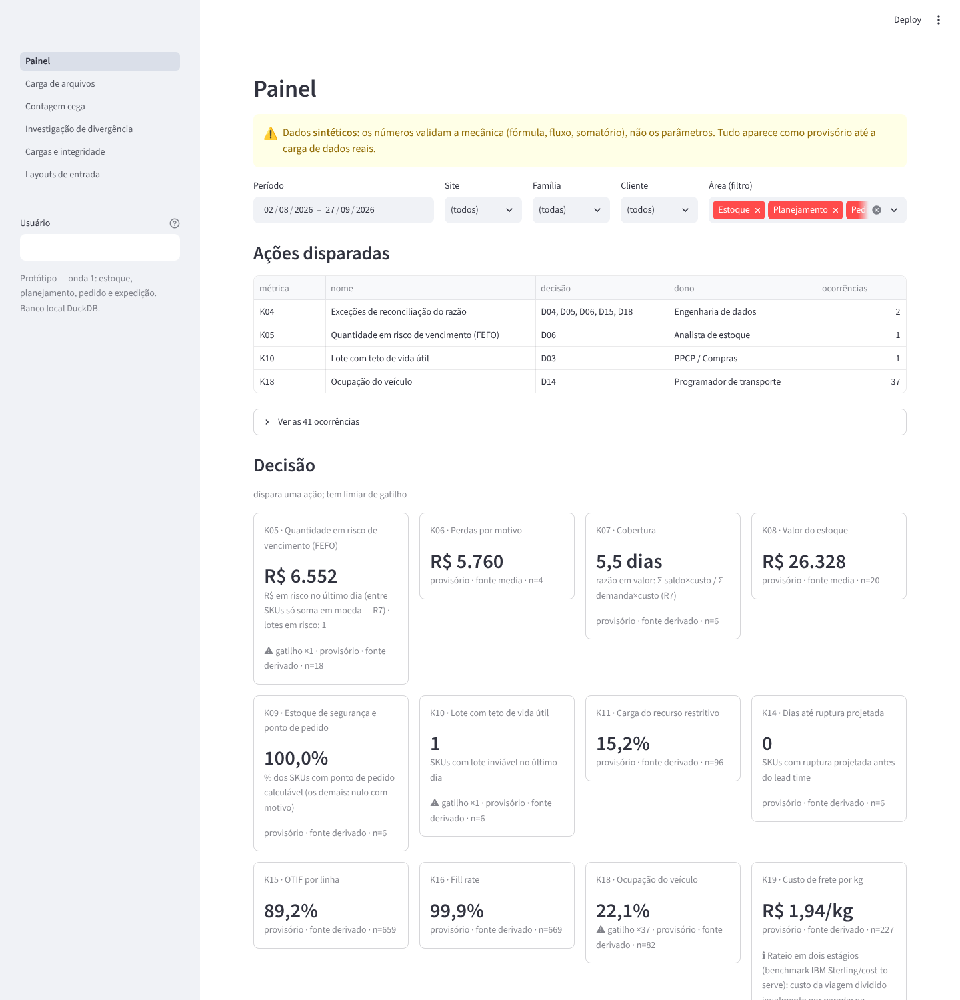

# Etapa 8 — Painel e fechamento da ferramenta (onda 1 completa)

**Entrada:** Etapas 0–7 aprovadas; autorização do dono do produto para executar o restante sem validação a cada etapa, resolvendo dúvidas por benchmark, com dados fictícios até a troca por dados reais.
**Status:** versão final da onda 1, testada (64 testes) sobre cenário sintético.

Legenda: **[F]** fato · **[I]** inferência · **[E]** especulação · **[D]** decisão de projeto · **[P]** valor que só vem do real · **[B]** escolha por benchmark.

---

## 1. O que existe

| Camada | Conteúdo | Onde |
|---|---|---|
| Entrada | 30 layouts canônicos (17 cadastros/parâmetros + 13 transacionais), todos com validação poka-yoke | `entrada/layouts.yaml`, `app/validacao.py` |
| Bruto | append-only, hash de conteúdo, NOVA/REPETIDA/CORRECAO, tudo ou nada, expurgo auditado só de sintético | `sql/bruto.sql`, `app/carga.py`, `app/admin.py` |
| Modelo | 22 dimensões/tabelas de referência; 14 fatos da Etapa 5 + F12b (risco por lote) + cobertura de saldo | `sql/modelo.sql`, `app/transform.py`, `app/transform_f23.py`, `app/planejamento.py` |
| Semântica | 20 métricas definidas uma vez; 15 visões analíticas; motor com R2–R9 | `semantica/metricas.yaml`, `sql/visoes.sql`, `app/metricas.py` |
| Telas | painel, carga de arquivo, contagem cega, investigação de divergência, cargas e integridade, layouts | `streamlit_app.py`, `app/telas.py`, `app/painel.py` |
| Simulação | planta + CD de lácteos, 8 semanas, todos os layouts gerados de um único estado | `dados_sinteticos/simulacao.py` |

**Desvio declarado do briefing:** o antipadrão "abrir mais de 3 frentes simultâneas" foi violado por autorização explícita (concluir toda a ferramenta antes do dado real). Custo: as frentes 2 e 3 foram construídas sem que a frente 1 tivesse sido validada com dado real. Se o dado real mostrar um problema estrutural na frente 1 (grão de saldo, layout do extrato), parte das frentes 2 e 3 será refeita.

## 2. Painel (Etapa 8)

Um painel só. **Área é filtro** (Estoque · Planejamento · Pedido e expedição), não página. Ordem de leitura:

1. **Ações disparadas** — cada gatilho acionado vira uma linha com a decisão da Etapa 0 que ele dispara e o dono. É o motivo de o painel existir.
2. **Números por classe** — Decisão, Diagnóstico, Integridade, separados (Etapa 2). Cada número mostra: valor, leitura agregada, marca de gatilho, "sem meta" quando proibida, **provisório**, **confiabilidade da fonte**, % estimado e n.
3. **Abrir métrica** — drill por qualquer dimensão que o YAML permite, ou por dia; gráfico + tabela + definição lida do YAML. Razão e percentil são recalculados em cada grupo (R4, R6).

Filtros em uma linha (período, site, família, cliente, área). Filtro que não se aplica à métrica é **ignorado e declarado**, não aplicado em silêncio.

Visualização (skill dataviz): uma série = uma cor (azul, slot 1); vermelho fica reservado a status; barras finas com ponta arredondada; grade recessiva; tooltip em toda marca; tabela sempre junto do gráfico; sem eixo duplo.

## 3. Dúvidas resolvidas por benchmark [B]

| Dúvida (etapa) | Escolha | Fonte | Onde falha |
|---|---|---|---|
| Estoque de segurança com demanda intermitente (Etapa 2, K09) | Classificar pela grade de Syntetos-Boylan (ADI 1,32; CV² 0,49). Suave → fórmula normal; errática/intermitente/irregular → **quantil empírico** da demanda no lead time (bootstrap de 2.000 amostras) | Syntetos & Boylan (2005); [MetricGate — Croston/SBA](https://metricgate.com/docs/syntetos-boylan-approximation/); [Racklify — safety stock intermitente](https://racklify.com/encyclopedia/safety-stock-calculation-for-intermittent-demand-techniques-and-examples/) | O bootstrap supõe que o passado da janela representa o futuro; com menos de `n_min` dias, o resultado é provisório |
| Tolerância de contagem (Etapa 7, dívida) | Padrão por classe ABC: **A 0%, B ±2%, C ±5%**, sobrescrito pelo parâmetro do SKU | [Open Exam Prep — cycle counting](https://open-exam-prep.com/study-guides/ca-red-seal-parts-technician/ch9-inventory-control-optimization/sec9-3-cycle-counting-physical-inventory); [Cleverence — cycle counting](https://www.cleverence.com/articles/for-business/cycle-counting-inventory-management-4823/) | **Não achei a fonte primária APICS/ASCM**; os números vêm de fontes secundárias. Validar contra o CPIM antes de usar como política |
| Rateio de frete por cliente (Etapa 6, K19) | **Dois estágios:** custo da viagem dividido igualmente por parada; dentro da parada, por peso | [IBM Sterling — freight allocation](https://www.ibm.com/support/pages/about-freight-allocation); [MIT — custo de multi-stop](https://dspace.mit.edu/handle/1721.1/107521) | O IBM rateia a viagem por **distância**; a ferramenta não tem distância (não roteiriza), então usa parada. Quando houver km por parada, trocar |
| Ordem das etapas do ciclo (Etapa 2, K17) | pedido → separação → faturamento → carregamento → entrega | prática de WMS (separa e confere antes de faturar) | Em operação que fatura antes de separar, a etapa 2 sai negativa; o tenant precisa reordenar (ainda não configurável na tela) |

## 4. O que o cenário sintético demonstra (mecânica, não parâmetro)

Os números abaixo são **sintéticos e provisórios**. Servem para mostrar que a ferramenta detecta o que foi plantado:

| Plantado na simulação | O que a ferramenta mostrou |
|---|---|
| 2 movimentos de expedição omitidos do extrato | **K04 = 2 exceções**, exatamente nos 2 dias e posições; os lançamentos retroativos não geraram exceção |
| Lote mínimo de leite (4.000 L) acima do que a vida útil comporta | **K10 alerta** para LEITE-L: teto 3.000 L (arredondado para baixo a múltiplo do contentor de 1.000 L) < lote mínimo |
| Compra forçada no lote mínimo | **K06 ≈ R$ 5,8 mil** em baixa por vencimento de leite: o custo do antipadrão "EOQ sem teto de vida útil" aparece no fechamento |
| Erros físicos ocultos (perda, troca de endereço) | Contagem cíclica → divergência → investigação → ajuste com etapa de origem; **K02b ≈ 4%** de origem desconhecida |
| Cortes por falta de saldo/validade e entregas fora da janela | OTIF por linha **≈ 89%** com fill rate **≈ 99,9%**: o corte pequeno reprova a linha inteira, como definido |
| SKU sem acuracidade comprovada | Ponto de pedido **nulo com motivo** ("acuracidade desconhecida/abaixo do limiar"), nunca zero |

## 5. Como trocar o fictício pelo real

1. **Apagar o sintético:** tela *Cargas e integridade → Apagar o histórico sintético* (digitar `APAGAR SINTETICOS`) ou `python -m app.admin limpar-sinteticos --usuario SEU_NOME --confirmar`. Só cargas marcadas como sintéticas são apagadas; o expurgo fica registrado em `bruto_expurgo`.
2. **Cadastros**, nesta ordem (referências fechadas exigem o anterior): `cad_site` → `cad_local` → `cad_sku` → `cad_sku_unidade` → `cad_colaborador` → `cad_cliente` → `cad_parceiro` → `cad_parceiro_sku` → `cad_veiculo` → `cad_recurso` → `cad_turno` → `cad_setup` → `cad_acordo_validade` → `cad_motivo` (opcional; há motivos padrão).
3. **Parâmetros:** `parametro_empresa` (regra de OTIF, limiares, janelas) e `parametro_sku_local` (nível de serviço, custos, dias parados, trânsito).
4. **Transacionais:** pedidos de venda e de compra, recebimento, programação, apontamento, separação, faturamento, viagem, entrega, movimentos.
5. **Saldo:** uma fotografia por site e dia (o layout baixa como modelo na tela de carga). Precisa de dois dias consecutivos para a reconciliação ser verificável.
6. **Conferir integridade antes de olhar o painel:** K04 (exceções de reconciliação) e a lista de membros inferidos (códigos usados sem cadastro).
7. **Só então** ler K09, K10, K14: eles saem de provisório quando houver `n_min` observações de demanda e de lead time **e** acuracidade medida.

## 6. Dívida técnica (o que a versão final NÃO faz)

| Item | Consequência | Quando resolver |
|---|---|---|
| Histórico de versão (T2) nas dimensões | Fator de conversão, capacidade e janela valem pela versão atual | Antes de comparar K18/K19 entre períodos com troca de embalagem ou frota |
| Multiempresa real e login | Uma empresa (`DEMO`), usuário digitado | Migração para PostgreSQL com permissão por tenant |
| Reconstrução total a cada carga | ≈ 30 s para 8 semanas sintéticas (84 cargas, carga em lote) **[I]**; em volume real cresce | Reconstrução incremental por fato, quando o volume real mostrar o gargalo |
| Ordem das etapas do ciclo e calendário (feriados) | Fixos no código (seg–sáb útil; ordem da §3) | Layout de calendário operacional e parâmetro de ordem por tenant |
| Banco em arquivo único (DuckDB) | Um escritor por vez: com o app aberto, o comando `app.admin` não consegue gravar (trava de arquivo). Use a tela ou feche o app | Migração para PostgreSQL |
| Roteirização | A ferramenta mede a carga (K18, K19), não otimiza o roteiro (D14) | Fora do escopo da onda 1 |
| Ondas 2 (D02, D10–D13, D16, D17, D19–D21) | Não construídas | Após validar a onda 1 com dado real |

## 7. Recalcular com dado real (consolidado)

| Parâmetro | Usado em | Origem |
|---|---|---|
| Demanda (d, σ_d) e padrão Syntetos-Boylan | K05, K07, K09, K10, K14 | Pedidos reais (F07), nunca faturamento |
| Lead time (L, σ_L) | K09, K13, K14 | Recebimentos reais ligados ao PC |
| Nível de serviço, custo de pedir, taxa de manter | K09, K10 | Gestor / contabilidade de custos |
| Shelf life, validade mínima (cliente, acordo), trânsito, dias parados | K05, K10 | Cadastro, contratos, rotas reais |
| Tolerância de contagem (hoje padrão ABC) | K01, aptidão de K09 | Política do tenant, validada contra a fonte primária |
| `apto_n_contagens`, `apto_limiar`, `n_min_observacoes`, janelas | F12 | Calibrar após o 1º ciclo de contagens reais |
| Tempo padrão e matriz de setup | K11 | Cronoanálise ou apontamento real |
| Regra de OTIF (tolerância) | K15 | Contrato/política comercial |
| Limiar de ocupação e de K02b | gatilhos K18, K02b | Gestor (hoje 15% e 30%, sintéticos) |
| Regra de rateio de frete (parada × distância) | K19 | Estrutura de custo real da frota |
| Todo o cenário de `dados_sinteticos/` | — | Serve só para mecânica; apagar antes do real |
